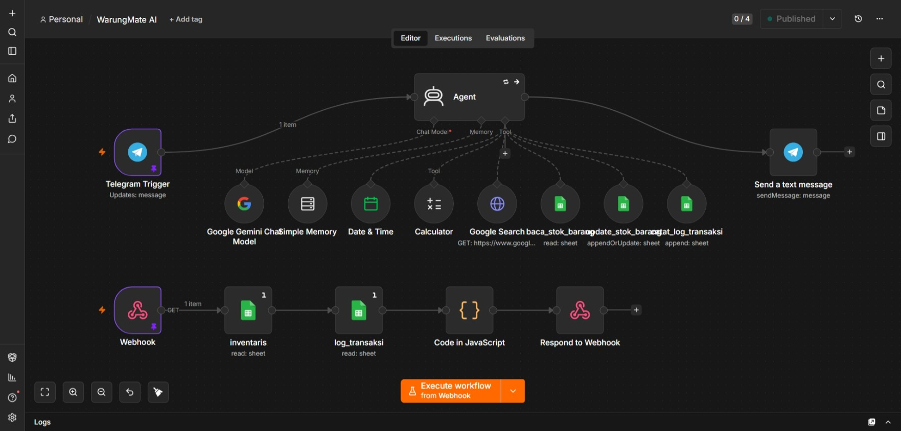

# 🏪 WarungMate AI

> Asisten AI berbasis Telegram untuk membantu pemilik warung mengelola stok, mencatat transaksi, dan memantau performa bisnis secara real-time melalui dashboard web.

## 📌 Tentang Proyek

WarungMate AI merupakan solusi digital yang dirancang khusus untuk pelaku UMKM, terutama warung kelontong, yang masih melakukan pencatatan stok dan transaksi secara manual. Melalui pendekatan percakapan alami di Telegram, pengguna dapat mengelola inventaris tanpa perlu mempelajari aplikasi kasir yang kompleks.

Dengan memanfaatkan Agentic AI, seluruh proses mulai dari memahami perintah pengguna, memperbarui stok, mencatat transaksi, hingga menyajikan analitik dilakukan secara otomatis.

---

# 🌐 Demo

- **Dashboard:** https://mategroup-id.github.io/WarungMate
- **Telegram Bot:** https://t.me/WarungMateBot
- **Telegram Web App:** https://t.me/WarungMateBot/dashboard
- **Database (Google Sheets):** https://docs.google.com/spreadsheets/d/1BW4zFsBjP54PCDJ-jQRrNqHPMfA_qVePI9uRqCm48FA

---

# 🎯 Permasalahan

Banyak pemilik warung masih menghadapi beberapa tantangan seperti:

- Pencatatan stok masih dilakukan secara manual.
- Sulit mengetahui jumlah stok yang tersedia.
- Tidak memiliki riwayat transaksi yang terdokumentasi dengan baik.
- Kesulitan menghitung omzet maupun produk terlaris.
- Aplikasi POS yang tersedia terlalu kompleks untuk kebutuhan warung kecil.

Akibatnya, banyak keputusan bisnis masih dilakukan berdasarkan perkiraan, bukan data.

---

# 💡 Solusi

WarungMate AI menghadirkan pengalaman yang jauh lebih sederhana.

Pengguna cukup mengirim pesan melalui Telegram menggunakan bahasa sehari-hari, misalnya:

> "Bos, indomie goreng keluar 3."

atau

> "Tambah stok gula pasir 10."

AI akan memahami maksud pengguna kemudian secara otomatis:

- mengidentifikasi produk,
- menentukan jenis transaksi,
- memperbarui stok,
- mencatat histori transaksi,
- serta memperbarui dashboard secara real-time.

Seluruh proses berlangsung tanpa pengguna harus membuka dashboard administrasi ataupun mengisi formulir.

---

# ✨ Fitur

## 🤖 AI Assistant

- Memahami bahasa alami Indonesia.
- Mendukung berbagai gaya penulisan.
- Tool Calling menggunakan Google Gemini.
- Agent mampu memilih tool secara otomatis.

---

## 📦 Manajemen Inventaris

- Melihat stok barang.
- Menambah stok.
- Mengurangi stok.
- Mengubah data inventaris.
- Menghitung stok secara otomatis.

---

## 📝 Pencatatan Transaksi

- Barang masuk.
- Barang keluar.
- Riwayat transaksi.
- Timestamp otomatis.
- Catatan transaksi.

---

## 🔍 Smart Product Matching

Menggunakan pencocokan nama produk yang toleran terhadap typo.

Contoh:

- indomi
- indomie
- mie goreng

Semua dapat dikenali sebagai produk yang sama.

---

## 📊 Dashboard Analytics

Dashboard web menampilkan:

- Total Produk
- Total Stok
- Total Transaksi
- Produk Terlaris
- Estimasi Omzet

beserta:

- tabel inventaris,
- tabel transaksi,
- filter data,
- refresh data,
- responsive layout.

---

## ⚡ Real-Time Synchronization

Setiap transaksi yang dilakukan melalui Telegram akan langsung memperbarui:

- Google Sheets
- Dashboard Web

tanpa proses sinkronisasi manual.

---

## 📱 Telegram Web App

Selain melalui browser, Dashboard WarungMate AI juga dapat dibuka langsung dari dalam Telegram menggunakan **Telegram Web App**.

Dengan satu tombol pada bot, pengguna dapat melihat dashboard tanpa berpindah aplikasi. Hal ini memberikan pengalaman yang lebih praktis karena seluruh aktivitas—mulai dari mencatat transaksi hingga memantau stok dan analitik—dapat dilakukan dalam satu ekosistem Telegram.

Keunggulan Telegram Web App:

- 📊 Dashboard dapat dibuka langsung dari chat Telegram.
- 🔄 Data inventaris dan transaksi diperbarui secara real-time.
- 📱 Responsif untuk perangkat mobile maupun desktop.
- 🚀 Tidak memerlukan instalasi aplikasi tambahan.

---

# 🏗️ Arsitektur

```
Telegram User
      │
      ▼
 Telegram Bot
      │
      ├──────────────► Telegram Web App (Dashboard)
      │                         │
      ▼                         │
      n8n                       │
      │                         │
      ▼                         │
 Google Gemini                  │
      │                         │
      ▼                         │
 Tool Calling                   │
      │                         │
      ▼                         │
 Google Sheets ◄────────────────┘
```

---

# 🛠 Tech Stack

| Komponen            | Teknologi                           |
| ------------------- | ----------------------------------- |
| Workflow Automation | n8n                                 |
| AI Model            | Google Gemini Flash Lite            |
| Messaging Platform  | Telegram Bot API + Telegram Web App |
| Database            | Google Sheets                       |
| API                 | Webhook API                         |
| Frontend            | HTML5, CSS3, Vanilla JavaScript     |

---

# ⚙️ Workflow Automation (n8n)

Berikut adalah workflow utama WarungMate AI yang dibangun menggunakan **n8n** sebagai orchestration engine. Workflow ini menghubungkan Telegram Bot, Google Gemini, Tool Calling, Google Sheets, dan Webhook API sehingga seluruh proses dapat berjalan secara otomatis.

<p align="center">
  
</p>

Alur workflow meliputi:

- 📩 Menerima pesan dari Telegram Bot.
- 🧠 Mengirim permintaan ke Google Gemini untuk memahami maksud pengguna.
- 🔧 Agent memilih tool yang sesuai (Tool Calling).
- 📦 Membaca atau memperbarui data inventaris dan transaksi di Google Sheets.
- 🌐 Menyediakan data terbaru melalui Webhook API.
- 📊 Dashboard Web dan Telegram Web App menampilkan data yang telah diperbarui secara real-time.

---

# 📂 Struktur Data

## Inventaris

| Field | Keterangan |
|--------|------------|
| nama_produk | Nama barang |
| kategori | Kategori |
| stok_sekarang | Jumlah stok |
| satuan | pcs, kg, dll |
| harga_satuan | Harga jual |

## Log Transaksi

| Field | Keterangan |
|--------|------------|
| timestamp | Waktu transaksi |
| nama_produk | Produk |
| jumlah | Kuantitas |
| jenis | masuk / keluar |
| catatan | Keterangan transaksi |

---

# 🚀 Cara Kerja

1. Pengguna mengirim pesan melalui Telegram.
2. n8n menerima pesan.
3. Gemini memahami maksud pengguna.
4. AI memilih tool yang diperlukan.
5. Tool membaca atau memperbarui Google Sheets.
6. Dashboard mengambil data terbaru melalui Webhook API.
7. Pengguna melihat perubahan secara real-time.

---

# 📈 Keunggulan

- Tidak memerlukan aplikasi POS.
- Tidak perlu belajar antarmuka baru.
- Menggunakan percakapan alami.
- Mudah digunakan pemilik warung.
- Ringan dan dapat dijalankan melalui browser.
- Dashboard responsif.
- Sinkronisasi data real-time.
- Mendukung pengambilan keputusan berbasis data.

---

# 🌏 Dampak bagi UMKM Indonesia

WarungMate AI membantu pelaku UMKM melakukan digitalisasi dengan pendekatan yang sederhana dan mudah dipahami.

Dengan memanfaatkan AI sebagai asisten virtual, pelaku usaha dapat:

- mengurangi kesalahan pencatatan,
- mengetahui kondisi stok secara real-time,
- memantau penjualan,
- memperoleh informasi produk terlaris,
- memperkirakan omzet,
- dan mengambil keputusan bisnis berdasarkan data.

Harapannya, solusi ini dapat menjadi langkah awal transformasi digital bagi jutaan warung tradisional di Indonesia.

---

# 👨‍💻 Dibuat Oleh

**Bagus Angkasawan Sumantri Putra**

---